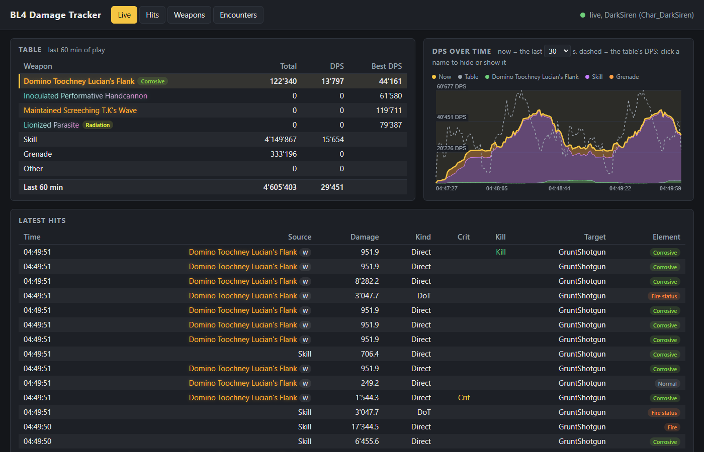
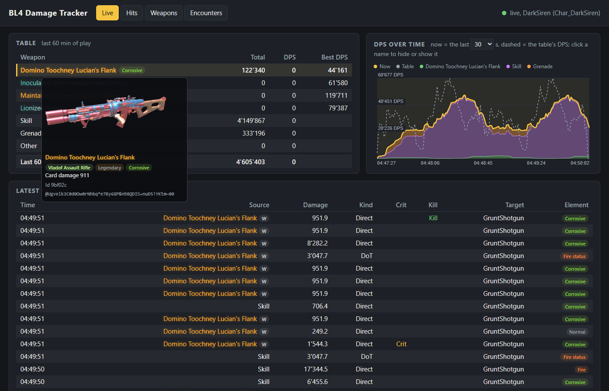
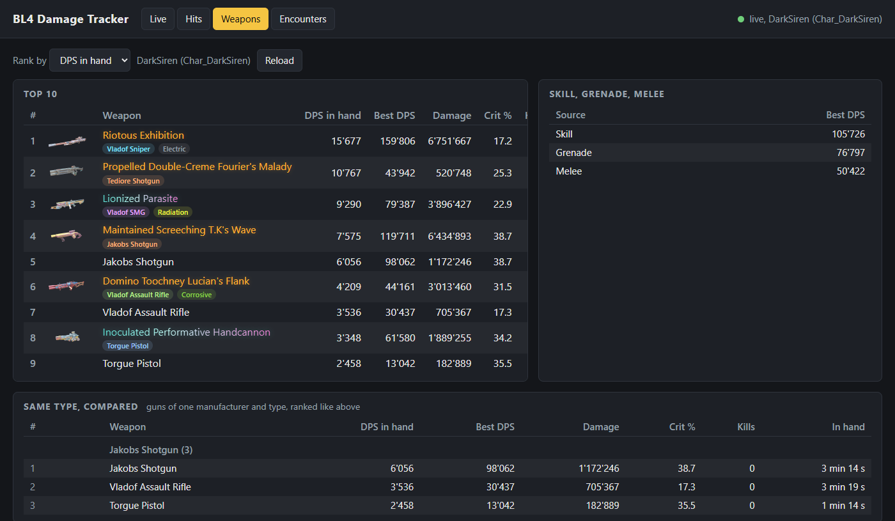
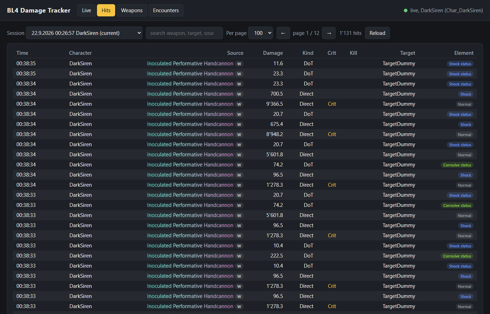
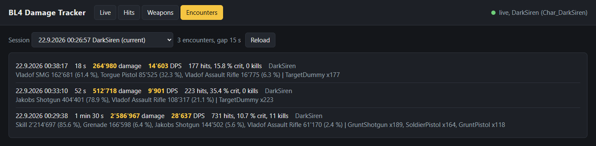

<div align="center">


# BL4 Damage Tracker

**See what your guns actually do in Borderlands 4.**

[](CHANGELOG.md)
-1f2a36?style=flat-square&logo=python&logoColor=white)

[](LICENSE)


-f5c542?style=flat-square)

[Quick start](#quick-start) ·
[Console commands](#console-commands) ·
[Web dashboard](#web-dashboard) ·
[Hook notes](docs/hook-notes.md) ·
[Development](#development)

</div>

---

Borderlands 4 (Gearbox, 2025) shows a damage number for every hit and nothing more. It does not
tell you whether the gun you just picked up beats the one you carry, how much of a fight your
action skill did, or what your grenade is worth.

**BL4 Damage Tracker** is a PythonSDK mod that records every damage instance you deal, shows a
per-weapon damage table on screen while you play, serves a live dashboard to your browser, and
keeps a lifetime record per gun and per character. Nothing is estimated: every number comes from
the damage instances the game records for its own floating damage numbers.

```
Weapon                   Total        DPS   Best DPS
Vladof Assault Rifle   442'795     26'047     31'202      <- the gun in hand is marked
Jakobs Shotgun         237'166     29'646     29'646
Vladof SMG             207'749     18'886     22'410
Torgue Pistol          168'461      7'657      9'980
Skill                2'034'870     20'349     24'118
Grenade                120'322      1'204      3'350
Other                    7'703         77

Last 60 min          3'219'066     32'190
```

<a href="docs/images/dashboard-live.png">
  
</a>

## Contents

- [Features](#features)
- [Status](#status)
- [Known issues](#known-issues)
- [Quick start](#quick-start)
- [Installation](#installation)
- [The on-screen table](#the-on-screen-table)
- [Console commands](#console-commands)
- [Web dashboard](#web-dashboard)
- [Screenshots](#screenshots)
- [Settings](#settings)
- [Files](#files)
- [How a fight is counted](#how-a-fight-is-counted)
- [Security](#security)
- [How it works](#how-it-works)
- [Roadmap](#roadmap)
- [Development](#development)
- [Credits](#credits)
- [Legal](#legal)
- [License](#license)

## Features

- **Every hit, attributed**: bullet impacts to the gun in hand, explosive rounds to their gun
  through the projectile that exploded, sticky rounds that detonate on a weapon swap to the
  previous gun, status ticks to the hit that set them, grenades, knife swings and action skills
  through the game's own throw, trick and skill events. Every hit records the rule that claimed
  it, so a wrong attribution can be found and explained.
- **On-screen table**: four weapon slots in slot order, then Skill, Grenade, Melee and Other, with
  the last hour's total, damage per second right now and the best DPS ever reached. Rows never
  move, and the table hides in menus, vehicles and tunnels.
- **Item names and pictures**: guns and grenades carry the names the game gives them
  ("Maintained Screeching T.K's Wave"), read from the game's own item cards, and the pictures the
  inventory renders.
- **Web dashboard**: a live table and chart pushed over a WebSocket, every hit of a session with
  search, the lifetime weapon ranking with the guns of one type compared, and the fights of a
  session. A phone or a second screen in the same network can show it.
- **Lifetime records**: per character, per gun and per grenade, across sessions: DPS while in
  hand, peak DPS, damage, hits, average hit, crit share, kills, minutes in hand.
- **Session logs**: one JSON line per hit, for your own tools or the bundled offline report.
- **Safe after a patch**: when the game moves the internals the mod reads, it logs one clear line
  and stays idle instead of misbehaving.
- **Standard library only**: the mod needs nothing but the PythonSDK. Its one dependency, the
  `websockets` package, is vendored.

## Status

> [!NOTE]
> **Tested on one system only.** Everything below that says "tested" ran on one machine: Windows
> 10 Pro 64-bit (build 19045), Borderlands 4 on Steam, the game build of 2026-09-19,
> oak2-mod-manager v0.3, and the release zip installed through Vortex with ChemBoy1's Borderlands
> 4 extension. Not tried yet: other game builds, the Epic release, Proton on Linux and the Steam
> Deck. Reports from other systems are welcome.

Tested in single player:

- the SDK loads the mod, and the per-hit numbers match the floating damage numbers on screen
  (controlled shots, the crit flag correct)
- the session log on disk without a stutter, a crash losing at most one second of hits
- the on-screen table, hidden in menus, vehicles, tunnels and cutscenes
- attribution of gun hits, explosive rounds, sticky detonations on a swap, status ticks, grenades,
  knife swings and action skills
- item names and pictures of the equipped guns and the grenade
- the web dashboard, the console commands and the offline report

Tested once in co-op:

- hosting a co-op game: damage and item names work; with other players in the session the mod
  ignores the action skill tricks, which carry no owner
- as a client: the guns' item identity is not replicated, so item names and pictures stay empty
  and the lifetime record does not merge with your single-player one; the damage numbers are
  unaffected, and the mod says so once in the log

## Known issues

- **Item names may stop working after a game patch.** They come from the game's own UI models,
  found in memory by their content ([docs/item-names.md](docs/item-names.md)). When the layout
  moves, the mod logs one line and the guns keep their manufacturer-and-type labels ("Jakobs
  Sniper") until the reader is updated.
- **A knife swing during a running action skill takes the skill's hits of that frame.** Damage
  that lands in the same frame as the swing cannot be told from the swing and counts as melee.
- **A very fast burst can overflow the game's ring.** The controller keeps six damage instances;
  more than six within one frame would lose the oldest. The log reports such frames.
- **Vehicle damage is not tracked**, and healing is never counted.

## Quick start

1. Install the [PythonSDK](https://github.com/bl-sdk/oak2-mod-manager) for Borderlands 4.
2. Download `dmgtracker-<version>.zip` from the releases, or build it from the checkout:

   ```sh
   git clone https://github.com/DaRealHansForSure/bl4-dps-tracker.git
   cd bl4-dps-tracker
   python build.py                  # build/dmgtracker.sdkmod and build/dmgtracker-1.3.1.zip
   ```

3. Extract the zip into the game folder, start the game, open the console in the world (F6), type
   `mods` and enable "BL4 Damage Tracker". The table appears with your first hit.

## Installation

Requirements:

- Borderlands 4 on Windows.
- The PythonSDK, [oak2-mod-manager](https://github.com/bl-sdk/oak2-mod-manager) v0.3. Nothing
  else: the mod brings its own copy of everything it uses.
- Python 3.11 or newer, only to build the release zip or run the tests; the SDK embeds its own
  Python 3.14.

**With Vortex** (needs ChemBoy1's Borderlands 4 extension): install the release zip through
Vortex, enable it and deploy. Vortex and the game must be on the same drive; the extension does not
support symlinks.

**By hand**: extract the release zip into the game folder
(`...\Steam\steamapps\common\Borderlands 4\`), which puts `sdk_mods\dmgtracker.sdkmod` in place.

**First launch**: open the console in the world (F6), type `mods`, and enable "BL4 Damage
Tracker". It stays enabled afterwards. The mod writes nothing into the game folder except its
settings file under `sdk_mods\settings\`.

## The on-screen table

- `Total` covers the **last 60 minutes of play** (`readout_window_minutes`). In a menu, a loading
  screen or a tunnel nothing ticks, because a pause is a pause.
- `DPS` is **damage per second right now**: a row's hits of the last 10 s (`readout_dps_seconds`)
  over the seconds in which it landed one. A gun that did 40'000 in one second reads 40'000,
  sustained fire reads its sustained rate, and ten seconds after a row's last hit it reads 0. The
  fair comparison between guns, damage per second *while a gun was in hand*, lives in the lifetime
  record (`dmgweapons`, the dashboard's Weapons tab).
- `Best DPS` is the highest value the `DPS` column ever reached for that row, over all sessions of
  the character. It only rises; `dmgreset --weapons` clears it.
- Three more columns can be switched on in the settings: `Share [%]` (share of the window total),
  `Crit [%]` (share of the row's direct hits that were crits; status ticks cannot crit and are left
  out) and `Kills`.
- A gun is recognised across sessions by its item identity (twelve seed bytes of the item), so a
  record follows the gun, not the slot or the session.
- Rows never move. Melee is hidden by default (`readout_hidden_rows`); a hidden row's damage still
  counts in the total. A gun swapped out of the slots drops from the table; its damage stays in the
  total and in its lifetime record. A row whose Total grows flashes briefly.
- Numbers use Swiss formatting: `'` for thousands, `.` for decimals.

## Console commands

Open the console with F6, in the world rather than the main menu. Every command takes `--help`.

```sh
dmgweapons                # rank this character's guns by DPS in hand, then the grenades
dmgweapons -n 30 --by damage
dmgreport                 # every fight of this session, a summary and a weapons table
dmgreport --last 300      # also the average over the final five minutes
dmgreset                  # start the on-screen table from zero
dmgreset --weapons        # also a fresh lifetime record for this character (--all: every one)
dmgreset --names          # forget the stored item names, so they are read from the game again
dmgweb --open             # print the dashboard address and open it in the browser
dmgstatus                 # counters, hooks, character, players, files, item identity, dashboard
```

| Command | What it does |
|---|---|
| `dmgweapons` | Ranks the current character's guns over all sessions: DPS in hand, peak DPS, damage, hits, average hit, crit share, kills, minutes in hand; then the grenades with their throws and damage per throw. |
| `dmgreport` | Each fight of the session (total, duration, DPS, active DPS, targets, kills, crit share, per-source split), a session summary and a weapons table. `--gap 30` changes the fight boundary. |
| `dmgreset` | Resets the on-screen table. Old lifetime records are kept as `weapons.reset-<timestamp>.json`. |
| `dmgweb` | Prints the dashboard's addresses on this machine and in the network. |
| `dmgstatus` | Shows the tracker's state, for a bug report or after a game patch. |

## Web dashboard

While the game runs, the mod serves a page at http://127.0.0.1:8765/, and at your machine's
network address, so a phone or a second screen in the same network can show it (`dmgweb` prints
both). Four tabs:

- **Live**: the in-game table with the item names in their rarity colour, an item card on hover
  (the gun's picture as the inventory renders it, rarity, element, the card's damage figure, the
  item code), a chart of the last 10 to 120 s with the sources stacked under the total and the
  fights shaded, and the latest hits as they land.
- **Hits**: every hit of a session with search (weapon, target, source, element, character, and
  the rule that claimed the hit) and pagination, for any of the kept sessions.
- **Weapons**: the character's lifetime ranking with a Top 10, the guns of one manufacturer and
  type compared with each other, the best DPS of Skill, Grenade and Melee, and the grenades ranked
  the same way.
- **Encounters**: the fights of a session with duration, total, DPS, crit share, kills, the
  per-source split and the targets.

The Live tab updates itself; the other tabs read the files when you open them or press Reload. The
server runs on its own threads, never on the game's. "Web dashboard" in the mod menu turns it on
and off. Windows may ask once whether the game may accept network connections; the answer only
matters for other devices.

| Setting | Default | Meaning |
|---|---|---|
| `web_host` | `0.0.0.0` | address to listen on; `127.0.0.1` keeps the dashboard on this machine |
| `web_port` | `8765` | TCP port |
| `web_chart_seconds` | `30` | the chart window the page starts with: 10, 30, 60 or 120 |

## Screenshots

The screenshots show a recorded session of a DarkSiren replayed into the dashboard: a fight against
soldiers with the action skill and a grenade, then two rounds at the target dummy. Click a picture
to see it full size.

<table>
  <tr>
    <td width="50%">
      <a href="docs/images/dashboard-live.png">
        
      </a>
      <p align="center"><b>Live</b>: the table, the chart and the latest hits.</p>
    </td>
    <td width="50%">
      <a href="docs/images/dashboard-item-card.png">
        
      </a>
      <p align="center"><b>Item card</b>: picture, rarity, element and item code on hover.</p>
    </td>
  </tr>
  <tr>
    <td width="50%">
      <a href="docs/images/dashboard-weapons.png">
        
      </a>
      <p align="center"><b>Weapons</b>: the lifetime ranking and guns of one type compared.</p>
    </td>
    <td width="50%">
      <a href="docs/images/dashboard-hits.png">
        
      </a>
      <p align="center"><b>Hits</b>: every hit of a session, searchable.</p>
    </td>
  </tr>
  <tr>
    <td colspan="2">
      <a href="docs/images/dashboard-encounters.png">
        
      </a>
      <p align="center"><b>Encounters</b>: each fight with its split per source and its targets.</p>
    </td>
  </tr>
</table>

## Settings

The mod menu (`mods` in the console) has the entries `Logging enabled`, `Show damage table`, `Web
dashboard` and `Open log folder`. Everything else lives in `sdk_mods\settings\dmgtracker.json`,
editable by hand while the game is closed:

| Setting | Default | Meaning |
|---|---|---|
| `log_dir` | `%LOCALAPPDATA%\BL4DamageTracker\logs` | where sessions are written; environment variables allowed |
| `readout_window_minutes` | `60.0` | the table's window for the totals, in minutes |
| `readout_dps_seconds` | `10.0` | how many last seconds the DPS column looks at |
| `readout_show_encounter_row` | `false` | add an `Encounter` row (the current fight, for bosses) |
| `readout_x`, `readout_y` | `32`, `320` | position of the table (top left corner, in pixels) |
| `readout_show_best_column` | `true` | the `Best DPS` column |
| `readout_show_share_column` | `false` | the `Share [%]` column |
| `readout_show_crit_and_kills` | `false` | the `Crit [%]` and `Kills` columns |
| `readout_hidden_rows` | `["melee"]` | non-weapon rows to leave out: `melee`, `grenade`, `skill`, `other` |
| `readout_item_names` | `false` | label the in-game weapon rows with the item name instead of manufacturer and type |
| `readout_font_size` | `30` | font size |
| `readout_column_gap`, `readout_column_widths` | `44`, `[320, 240, 190, 140]` | column layout |
| `readout_background_alpha` | `0.6` | background darkness |
| `encounter_gap_s` | `15.0` | seconds without a hit that end a fight |
| `sessions_to_keep` | `20` | session files kept |
| `flush_interval_s` | `1.0` | how often the log reaches the disk |
| `tick_function`, `ring_property`, `ring_size` | game internals | only relevant after a game patch, see [docs/hook-notes.md](docs/hook-notes.md) |

## Files

Everything the mod writes goes to `%LOCALAPPDATA%\BL4DamageTracker\`. The "Open log folder" button
in the mod menu gets you there.

| Path | Content |
|---|---|
| `logs\session-<date>-<time>.jsonl` | one file per game launch, one JSON line per hit, plus a meta line and a marker whenever you switch character; the newest 20 are kept |
| `logs\latest-session.txt` | the name of the running session |
| `characters\<character id>\weapons.json` | that character's lifetime record, the grenades included |
| `item-names.json` | the item names read so far, one table for every character |
| `thumbnails\` | the gun pictures, exported from the inventory's renders |

## How a fight is counted

A fight starts with the first damage instance you deal and ends after `encounter_gap_s` seconds
(default 15) without a hit; nothing else defines it, not the enemies and not your health. Per fight
the mod counts total damage, hits, crits, kills, status damage, the split per source, the targets,
and two rates: DPS (total over the fight's length) and active DPS (total over the seconds in which
a hit landed). Two groups of enemies within 15 s are one fight; a boss phase longer than the gap
splits it. The details: [docs/encounters.md](docs/encounters.md).

## Security

**The dashboard has no login.** It is meant for your own machine and your own network, and it is
read-only: the HTTP API and the WebSocket only hand out what the mod recorded, and nothing a
client sends can change the game, the records or the files. See [SECURITY.md](SECURITY.md) for
what it exposes and how to report a problem.

- By default the dashboard listens on every interface, so anyone in your network can read your
  damage numbers, character names and item names. Set `web_host` to `127.0.0.1` to keep it on this
  machine, or switch it off in the mod menu. Never forward its port to the internet.
- A request whose browser `Origin` names another site is refused, so a web page you visit cannot
  read the dashboard through your browser.
- The item name reader only reads the game's own memory, through `ReadProcessMemory` on the
  current process, which fails cleanly on unmapped pages instead of crashing. It never writes.
- Every read of a game structure is checked against its expected content first, so a game patch
  that moves a field makes the mod stop with one log line rather than misread.

## How it works

Borderlands 4 applies damage natively; no Unreal function fires per hit. The local player
controller keeps a six-slot ring of the damage instances it caused, the source of the floating
damage numbers. The mod hooks a per-frame UI function, diffs the ring's dirty flags, and records
every new instance, then works out whose it is.

[docs/hook-notes.md](docs/hook-notes.md) describes the hooks, the fields read and the dead ends.
[docs/item-names.md](docs/item-names.md) describes how the item names and pictures are found.
[docs/encounters.md](docs/encounters.md) defines a fight. `poc/findings.md` keeps the evidence of
the proof of concept.

The code follows the same layers:

| Module | Responsibility |
|---|---|
| `dmgtracker/mod.py` | SDK glue: options, the per-frame hook, enable and disable, the console commands |
| `dmgtracker/poller.py` | the hot path: once per frame, which damage instances are new, and whose they are |
| `dmgtracker/attribution.py` | which source dealt a damage instance, and what to call it |
| `dmgtracker/character.py` | the identity of the current character, for per-character records |
| `dmgtracker/itemidentity.py` | a weapon identity that survives restarts: the seed bytes of the item |
| `dmgtracker/itemnames.py` | the item names of the equipped guns, read from the game's UI models |
| `dmgtracker/itemnamestore.py` | the item names and item details, one table for every character |
| `dmgtracker/thumbnails.py` | the gun pictures the inventory renders, exported as PNG files |
| `dmgtracker/stats.py` | the stats engine: fights and a rolling window, fed one hit at a time |
| `dmgtracker/table.py`, `dmgtracker/readout.py` | the on-screen table as data, and as a UMG widget |
| `dmgtracker/weaponstats.py` | the lifetime per-weapon record, as JSON next to the logs |
| `dmgtracker/logwriter.py` | the session log: a buffer a background thread appends to a JSONL file |
| `dmgtracker/report.py` | the offline report over one session, also `dmgreport` |
| `dmgtracker/dashboard.py`, `dmgtracker/webdata.py` | the dashboard's HTTP and WebSocket server, and its API |
| `dmgtracker/web/index.html` | the dashboard page |
| `dmgtracker/formatting.py` | number formatting for everything the user reads |
| `dmgtracker/_vendor/websockets/` | the vendored `websockets` 16.0 package |

## Roadmap

Planned or wished for, roughly in order. [docs/chart-ideas.md](docs/chart-ideas.md) has each idea
with what it needs.

- **Marks on the live chart**: every hit as a dot, bands for the action skill, ticks for grenade
  throws and weapon swaps, so a spike explains itself.
- **Fight detail and comparison** in the Encounters tab: one fight's DPS curve by source, and a
  bar per fight to show a session's progression.
- **A breakdown panel** next to the chart, and a session strip under it.
- **Damage per enemy and time to kill.**
- **Item names in co-op as a client**, from the UI models' serials instead of the item identity.
- **Export** of a session or a ranking.

## Development

Run the tests and build the release from the checkout:

```sh
python -m unittest discover -s tests -t .                # every module that does not touch the SDK
python build.py                                          # build/dmgtracker.sdkmod and the release zip
python dmgtracker/report.py [session.jsonl] [--last 300] # the offline report over a session log
```

To develop against the game, link `sdk_mods\dmgtracker` to the repository's `dmgtracker` folder
with a directory junction. `poc/reload_mod.py` reloads the mod without restarting the game, and
`poc/record_attribution.py` with `poc/replay_capture.py` records a fight's attribution inputs and
replays them through the poller as often as the rules change.

The code uses four-space indentation, braces on every JavaScript block, plain `if` statements
instead of compound conditional expressions, and the standard library only (`.editorconfig` holds
the layout). Branches follow git flow: work lands on `develop`, each release is merged into `main`
and tagged `vX.Y.Z` there, then merged back into `develop`. Releases are listed in the
[changelog](CHANGELOG.md).

## Credits

Borderlands 4 was made by Gearbox Software; without their game there would be nothing to measure.
The mod stands on the [PythonSDK](https://github.com/bl-sdk/oak2-mod-manager) by the bl-sdk team,
which makes Python mods for the game possible at all, and on ChemBoy1's Borderlands 4 extension
for Vortex. The dashboard runs on [websockets](https://github.com/python-websockets/websockets) by
Aymeric Augustin and contributors.

## Legal

Borderlands is a trademark of Gearbox Software and Take-Two Interactive. This project is not
affiliated with or endorsed by them. It contains no code or data from the game; it reads the game's
memory at runtime, on the player's own machine, through the community PythonSDK. The mod neither
ships nor downloads the game: every player needs their own copy of Borderlands 4.

The vendored `websockets` package in `dmgtracker/_vendor/websockets/` is distributed under its own
BSD license, included next to it.

## License

BL4 Damage Tracker is released under the [MIT License](LICENSE). Copyright (c) 2026
DaRealHansForSure.

The game's internals were worked out by studying a legally owned copy, and the code was written
from scratch by DaRealHansForSure. You may use, change and share it, also in your own projects, as
long as you keep the copyright notice and name the author. A link back to this repository is
appreciated.
